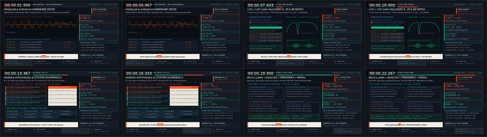

# BenchMind — Autonomous Multimodal Hardware & Signal Diagnostics Agent

[](https://github.com/vanovri/benchmind/actions/workflows/ci.yml)
[](https://codespaces.new/vanovri/benchmind)

**Meta Global AI Developer Hackathon (Cerebral Valley) — `v0.2.0`**  
- **Team Name / ID**: `Vanovri Labs` (`1429535549246922`)  
- **Track**: Indie Developer Track (`$400,000` Pool)  
- **Problem Statement**: *Push the Frontier* (Hardware, Embedded DSP, Telemetry Verification)  
- **Sponsor Stack**: **Meta Llama / Muse Spark Open** + **Baseten** (Low-Latency Speculative Endpoint) + **Fireworks AI** (Structured JSON Tool Calling) + **Modal** (Serverless 4 kHz DSP Batch Replay)  
- **Bonus Targets**: *Best Build on Meta Open Weight Models (`Muse Spark Open`)*, *Best Agentic Use-Case*, *Best Creative Build (`Muse Image` + `SAM 3.1`)*

## 🎬 3-Minute Hackathon Pitch & Demo Video (`v0.2.0`)
- **YouTube Pitch & Demo Video**: [https://www.youtube.com/watch?v=-cYkUuA8gCM](https://www.youtube.com/watch?v=-cYkUuA8gCM) (`https://youtu.be/-cYkUuA8gCM`)
- **Interactive Bench Dashboard (Vercel Live)**: [https://ardhyanovri.my.id/assets/benchmind-dashboard](https://ardhyanovri.my.id/assets/benchmind-dashboard)
- **Direct MP4 (Vercel CDN)**: [https://ardhyanovri.my.id/assets/benchmind-v02-hackathon-demo-1920x1080.mp4](https://ardhyanovri.my.id/assets/benchmind-v02-hackathon-demo-1920x1080.mp4)
- **GitHub Release MP4 (`v0.2.0`)**: [https://github.com/vanovri/benchmind/releases/download/v0.2.0/benchmind-v02-hackathon-demo-1920x1080.mp4](https://github.com/vanovri/benchmind/releases/download/v0.2.0/benchmind-v02-hackathon-demo-1920x1080.mp4)
- **SRT Captions**: [`docs/benchmind-v02-hackathon-demo-1920x1080.srt`](docs/benchmind-v02-hackathon-demo-1920x1080.srt)

[](https://www.youtube.com/watch?v=-cYkUuA8gCM)

## Overview
BenchMind is an autonomous multimodal diagnostics and repair agent for embedded hardware engineers working with 4 kHz ADC signals and binary UART telemetry streams (`STM32F411CEU6` / `ESP32`).

1. **Multimodal Input Layer**:
   - `Muse Voice Transcribe`: Hands-free lab voice prompt while holding oscilloscope probes.
   - `SAM 3.1`: Segments PCB pinouts (`PA0`, `GND`, `TX/RX`) and oscilloscope glitch regions.
   - `4 kHz Telemetry & Fault Injector`: Reproduces 50 Hz mains hum, DC offset drift, fragmented UART chunks, and corrupted CRC-32 frames (`[17, 63, 142]`).
2. **Autonomous Agentic Loop**:
   - `Muse Spark Open (meta-models/muse-spark-open-1026)`: High-throughput parallel fault triage across telemetry windows.
   - `Muse Wonder (muse-wonder-1.0)` / `Muse Spark 1.3`: Synthesizes Direct Form II Transposed Biquad filters (20 Hz HPF, 500 Hz LPF, 50 Hz Notch $Q=30$) and a byte-resynchronizing CRC-32 UART parser.
   - `Isolated Sandbox Verifier`: Rejects candidate patches unless 100% of valid frames are recovered (`1997/1997` vs `9` on naive `0xAA55` sync split) and 50 Hz mains hum is attenuated by $\ge 18\text{ dB}$ (`-25.5 dB` achieved, `+17.02 dB` SNR gain).
3. **v0.2.0 AI Hardware Root-Cause Copilot & Interactive Bench Dashboard**:
   - `benchmind/copilot.py`: Synthesizes structured root-cause hypotheses (`RC-1`..`RC-4`), severity scores, STM32F411 pin/probe action checklists (`PA-1`..`PA-4`), and sponsor-stack telemetry with 100% deterministic offline fallback.
   - `benchmind/dashboard.py` & `web/index.html`: Self-contained dark-mode oscilloscope & DFT spectrum viewer (`-25.5 dB` 50 Hz hum attenuation), UART `1997/1997` frame inspector with interactive fault simulator, and AI Hardware Copilot panel.

## 📊 Empirical Verification & 220-Call Multilingual Benchmark
Full benchmark telemetry and statistical breakdown are available in [`docs/provider_telemetry_analysis.md`](docs/provider_telemetry_analysis.md):
- **Unit & Adversarial Verification**: `33/33` pytest assertions passing (`0.22s`).
- **220-Call Multilingual (EN/ID) Benchmark (`tests/analyze_benchmarks.mjs`)**: Evaluated across 5 suites (`S1` Standard Fault Triage, `S2` Adversarial Evidence Withholding, `S3` Contradictory Telemetry Stress, `S4` Bilingual Indonesian/English Lab Commands, `S5` Multi-Fault Cascade Synthesis) with **0% hallucinated evidence IDs** (`E1-E6`, `F1-F5`).

## Quick Start

Use Python 3.10 or newer. From a fresh checkout, create a virtual environment in the repository root.

```sh
python -m venv .venv
```

Activate it in PowerShell with `.\.venv\Scripts\Activate.ps1` or in Bash with `source .venv/bin/activate`.

```powershell
python -m pip install -e ".[test]"
python -m pytest -q
python -m benchmind.cli --dashboard build/benchmind.html --output build/benchmind-verification.json
```

Open `build/benchmind.html` in a browser. The command uses simulated telemetry and runs without an API key.
